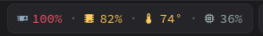
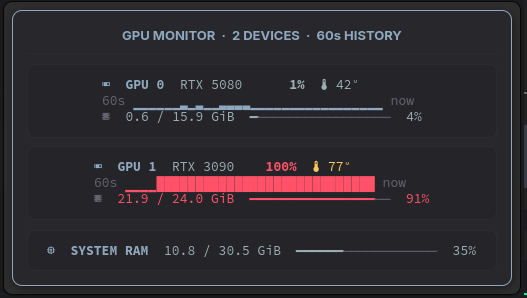

# ironbar-gpu-top

A small, self-contained NVIDIA monitor module for Ironbar 0.18+. It keeps the
bar view compact and opens an `nvtop`-inspired details panel on click.

**Compact bar view**

**Expanded GPU monitor**

The summary shows the busiest GPU, the fullest individual VRAM pool, hottest GPU
temperature, and system RAM as percentages. The popup shows each GPU separately
with a ~60-second utilization sparkline, exact VRAM use and fill bar, temperature,
and a system RAM fill bar.

## Requirements

- Ironbar 0.18 or newer
- `nvidia-smi`
- POSIX `sh`, `awk`, `sed`, and `grep`
- Optional: a Nerd Font for Material icons

The intended appearance uses a Nerd Font, but it is optional. In the default
`auto` mode, ironbar-gpu-top checks Fontconfig once and falls back to plain
`GPU`, `VRAM`, `TEMP`, and `RAM` labels when no Nerd Font is available. Graphs,
meters, values, and warning colors continue to work in text mode. If Fontconfig
is unavailable, text mode is selected automatically.

Only the summary process calls `nvidia-smi` (once every two seconds). All popup
cards read the cached sample, so opening them does not create another GPU polling
loop.
Runtime state is kept below `$XDG_RUNTIME_DIR` (or `/tmp` as a fallback).

## Install

1. Put this directory at `~/.config/ironbar/modules/ironbar-gpu-top`.
2. Make `ironbar-gpu-top` executable.
3. Copy the `$gpu_top` block from `module.corn` into your config's `let` block.
4. Add `$gpu_top` to your bar's module array.
5. Append `style.css` to your Ironbar stylesheet.

The example paths assume the directory above. Change the commands in
`module.corn` if you install elsewhere. The example includes GPU indices 0 and 1;
add or remove `gpu-top-device` labels for a different device count. The renderer
accepts any valid NVIDIA GPU index.

## Theme colors

The script accepts these environment variables: `IRONBAR_GPU_TOP_NORMAL_COLOR`,
`IRONBAR_GPU_TOP_ACCENT_COLOR`, `IRONBAR_GPU_TOP_QUIET_COLOR`,
`IRONBAR_GPU_TOP_WARM_COLOR`, and `IRONBAR_GPU_TOP_HOT_COLOR`. The bundled CSS
contains self-contained Foocolors defaults under `gpu_top_*` color names. Edit
those declarations to match another palette. Module selectors are scoped under
`ironbar-gpu-top`.

Set `IRONBAR_GPU_TOP_ICONS` to `auto` (default), `nerd`, or `text`. To force a
mode from the Ironbar config, prefix each command with
`env IRONBAR_GPU_TOP_ICONS=text` (or `IRONBAR_GPU_TOP_ICONS=nerd`). Automatic
detection is cached for the current login under `$XDG_RUNTIME_DIR`; an explicit
setting always overrides that cache.

Thresholds are deliberately quiet: normal below 75%, gold from 75%, coral from
90%. Temperature changes to gold at 72°C and coral at 85°C.
